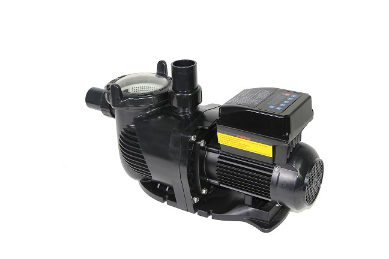
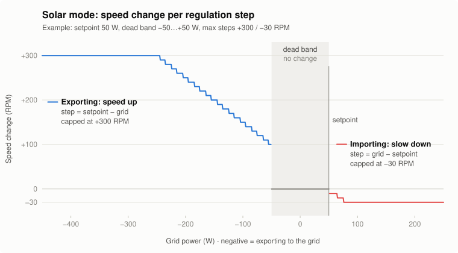
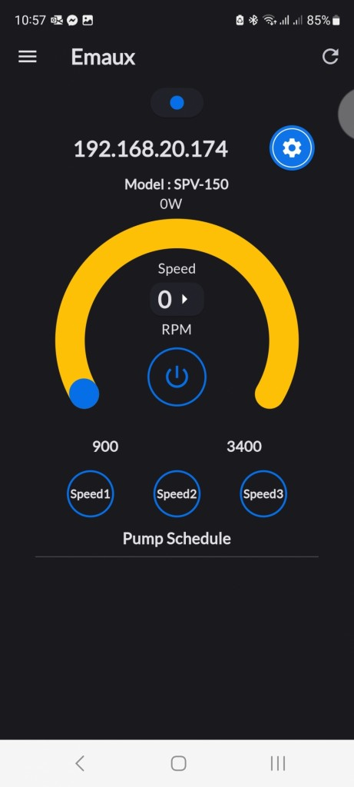

# Emaux SPV150 pour Home Assistant

[English](./README.md) | **Français**

[](https://hacs.xyz/)
[](https://github.com/0jety0/emaux_spv150/releases)
[](https://analytics.home-assistant.io/custom_integrations)
[](https://github.com/0jety0/emaux_spv150/actions/workflows/ci.yaml)
[](https://github.com/astral-sh/ruff)
[](LICENSE)

Intégration Home Assistant pour superviser et piloter la pompe de piscine à vitesse variable **Emaux SPV150** sur
le réseau local, avec un **mode solaire** qui ajuste la vitesse de la pompe au surplus de vos panneaux.



## Fonctionnalités

### Supervision
- Puissance consommée (W) et débit (affiché en L/min) en temps réel
- Énergie cumulée (kWh), utilisable dans le tableau Énergie de Home Assistant
- Temps de fonctionnement depuis le dernier démarrage

### Contrôle
- Vitesse courante (tr/min) et preset de vitesse (1/2/3) modifiables depuis l'interface
- Intervalle minimal entre deux changements de vitesse (défaut : 60 s) pour protéger la pompe
- Timeout de requête et intervalle de polling modifiables à chaud, pour ne pas surcharger le petit serveur web de la pompe
- Prise connectée ou switch optionnel qui alimente la pompe : tant qu'il est éteint, la pompe n'est pas interrogée et aucune erreur n'est signalée
- Séquence de démarrage : quand le switch allume la pompe, le mode solaire attend la fin de l'amorçage (défaut : 120 s, selon la notice SPV150, section 5)

### Mode solaire
- Sélecteur de mode : `Off` / `Manuel` / `Solaire`, conservé entre les redémarrages
- Lit un capteur de puissance réseau (positif en soutirage, négatif en injection) et ajuste la vitesse pour garder la puissance réseau proche d'une consigne : voir [Fonctionnement du mode solaire](#fonctionnement-du-mode-solaire)
- Consigne, bande morte, pas maximaux et vitesses min/max sont des entités : modifiables depuis un dashboard ou une automatisation

## Installation

Nécessite **Home Assistant 2026.10** ou plus récent.

### Via HACS (recommandé)

[](https://my.home-assistant.io/redirect/hacs_repository/?owner=0jety0&repository=emaux_spv150&category=integration)

Ou à la main :

1. Vérifiez que [HACS](https://hacs.xyz/) est installé.
2. Dans HACS, ouvrez le menu (⋮) > **Dépôts personnalisés**.
3. Ajoutez `https://github.com/0jety0/emaux_spv150` avec le type **Intégration**.
4. Installez **Emaux SPV150**, puis redémarrez Home Assistant.

Les mises à jour apparaissent ensuite dans **Paramètres > Mises à jour**.

### Installation manuelle

1. Copiez le dossier `custom_components/emaux_spv150` dans `config/custom_components/` de votre Home Assistant.
2. Redémarrez Home Assistant.

## Configuration initiale

[](https://my.home-assistant.io/redirect/config_flow_start/?domain=emaux_spv150)

Ou **Paramètres > Appareils & services > Ajouter une intégration > Emaux SPV150**, puis :

1. Saisissez l'adresse IP de la pompe.
2. (optionnel) Choisissez la prise ou le switch qui alimente la pompe.
3. (optionnel) Choisissez le capteur de puissance réseau utilisé par le mode solaire.

La pompe est contactée avant la création de l'entrée (test sauté si le switch choisi est éteint). Une même adresse IP
ne peut pas être ajoutée deux fois. Pour changer plus tard l'adresse IP ou les entités : **⋮ > Reconfigurer**.

## Options configurables

**Paramètres > Appareils & services > Emaux SPV150 > Configurer** :

| Option | Description | Défaut |
|--------|-------------|--------|
| Adresse IP | Adresse IP de la pompe | — |
| Switch externe | Prise ou switch qui alimente la pompe : tant qu'il est éteint, la pompe n'est pas interrogée | — |
| Capteur puissance réseau | Capteur de puissance utilisé par le mode solaire | — |
| Consigne (W) | Puissance réseau visée par le mode solaire | 0 W |
| Borne basse de la bande morte (W) | En dessous : accélérer | 0 W |
| Borne haute de la bande morte (W) | Au-dessus : ralentir | 100 W |
| Pas max de montée (tr/min) | Plus forte hausse de vitesse en un pas | 300 tr/min |
| Pas max de descente (tr/min) | Plus forte baisse de vitesse en un pas | 30 tr/min |
| Délai d'amorçage (s) | Attente après l'allumage par le switch, avant que le mode solaire agisse | 120 s |
| Intervalle entre changements de vitesse (s) | Temps minimal entre deux changements (0 = sans limite) | 60 s |

L'intervalle de polling (5 à 60 s, défaut 30 s), le timeout de requête (1 à 30 s, défaut 5 s) et les vitesses
min/max du mode solaire sont des entités number.

## Fonctionnement du mode solaire

À chaque polling, le régulateur compare la puissance réseau à la bande morte et déplace la vitesse de la pompe d'un pas :

<picture>
  <source media="(prefers-color-scheme: dark)" srcset="img/regulation-dark.svg">
  
</picture>

- **Injection** (puissance réseau sous la bande morte) : la pompe accélère de `consigne − puissance réseau` tr/min,
  au moins 10, au plus le pas max de montée. Plus le surplus est grand, plus le pas est grand.
- **Dans la bande morte** : rien ne change.
- **Soutirage** (au-dessus de la bande morte) : la pompe ralentit de `puissance réseau − consigne` tr/min, au moins
  10, au plus le pas max de descente.
- La nouvelle vitesse reste entre les vitesses min et max du mode solaire, arrondie à 10 tr/min.

Avec les réglages du graphe (consigne 50 W, bande morte −50…+50 W, pas max +300 / −30 tr/min) :

| Puissance réseau | −400 W | −150 W | −100 W | −50…+50 W | +60 W | +200 W |
|---|---|---|---|---|---|---|
| Variation de vitesse | +300 tr/min | +200 tr/min | +150 tr/min | aucune | −10 tr/min | −30 tr/min |

La bande morte évite que la pompe oscille autour de la consigne. Un grand pas de montée et un petit pas de descente
lui font capter vite un surplus et le rendre en douceur quand un nuage passe. Un pas n'est appliqué que si tout ceci
est vrai :

- le mode est `Solaire` et la pompe tourne ;
- le délai d'amorçage est écoulé depuis que le switch externe a allumé la pompe ;
- le capteur de puissance réseau a une valeur numérique remontée il y a moins de 60 s ;
- l'intervalle entre changements de vitesse est écoulé depuis le dernier (60 s par défaut) : au plus un pas par minute.

## Entités créées

Identifiants d'entité par défaut sur une nouvelle installation (ils suivent les noms de l'appareil et des entités) :

| Entité | Type | Description |
|--------|------|-------------|
| `sensor.emaux_spv150_power` | Sensor | Puissance consommée (W) |
| `sensor.emaux_spv150_flow_rate` | Sensor | Débit (affiché en L/min) |
| `sensor.emaux_spv150_energy` | Sensor | Énergie cumulée (kWh) |
| `sensor.emaux_spv150_uptime` | Sensor | Temps de fonctionnement (h), diagnostic |
| `number.emaux_spv150_speed` | Number | Vitesse courante (tr/min), slider |
| `number.emaux_spv150_speed_preset` | Number | Preset de vitesse (1/2/3), slider |
| `number.emaux_spv150_setpoint` | Number | Consigne du mode solaire (W) |
| `number.emaux_spv150_dead_band_lower_bound` | Number | Borne basse de la bande morte (W) |
| `number.emaux_spv150_dead_band_upper_bound` | Number | Borne haute de la bande morte (W) |
| `number.emaux_spv150_max_speed_increase_step` | Number | Pas max de montée (tr/min) |
| `number.emaux_spv150_max_speed_decrease_step` | Number | Pas max de descente (tr/min) |
| `number.emaux_spv150_min_speed_solar` | Number | Vitesse min en mode solaire (tr/min) |
| `number.emaux_spv150_max_speed_solar` | Number | Vitesse max en mode solaire (tr/min) |
| `number.emaux_spv150_polling_interval` | Number | Intervalle de polling (s) |
| `number.emaux_spv150_request_timeout` | Number | Timeout de requête HTTP (s) |
| `switch.emaux_spv150_running` | Switch | Démarrer / arrêter la pompe |
| `select.emaux_spv150_control_mode` | Select | Off / Manuel / Solaire |

## Exemples

Faire tourner la pompe sur le surplus solaire en journée, via la prise qui l'alimente
(remplacez `switch.pool_pump_plug` par la vôtre) :

```yaml
automation:
  - alias: "Pompe piscine : démarrage solaire le matin"
    triggers:
      - trigger: time
        at: "10:00:00"
    actions:
      - action: switch.turn_on
        target:
          entity_id: switch.pool_pump_plug
      - action: select.select_option
        target:
          entity_id: select.emaux_spv150_control_mode
        data:
          option: solar

  - alias: "Pompe piscine : arrêt le soir"
    triggers:
      - trigger: time
        at: "19:00:00"
    actions:
      - action: switch.turn_off
        target:
          entity_id: switch.pool_pump_plug
```

Repasser à vitesse fixe quand la production solaire reste faible (remplacez `sensor.solar_power` par le vôtre) :

```yaml
automation:
  - alias: "Pompe piscine : vitesse fixe sans soleil"
    triggers:
      - trigger: numeric_state
        entity_id: sensor.solar_power
        below: 300
        for: "00:15:00"
    actions:
      - action: select.select_option
        target:
          entity_id: select.emaux_spv150_control_mode
        data:
          option: manual
      - action: number.set_value
        target:
          entity_id: number.emaux_spv150_speed
        data:
          value: 1500
```

## Mise à jour des données

- La pompe est interrogée toutes les 30 s par défaut (5 à 60 s, modifiable à chaud) avec une seule requête HTTP.
- Après une commande (vitesse, preset, marche/arrêt), la pompe est relue une fois stabilisée (2 s).
- Un changement d'état du switch externe déclenche une lecture immédiate.
- Tant que le switch externe est éteint, la pompe n'est pas interrogée : ses valeurs sont indisponibles et aucune erreur n'est signalée.
- Une pompe qui ne répond pas n'est pas une erreur tant que son switch n'est pas allumé (éteint, inconnu ou indisponible, comme une prise connectée l'est un moment après chaque redémarrage de Home Assistant), ni pendant les 3 minutes qui suivent son allumage, le temps que la pompe se connecte au Wi-Fi. Sinon elle est signalée : une ligne de log, valeurs indisponibles.

## Appareils supportés

Pompes à vitesse variable Emaux SPV150 avec le module Wi-Fi intégré, celles que l'on pilote avec l'appli mobile
Emaux. L'intégration parle au même serveur web local. Les autres modèles Emaux n'ont pas été testés.



## Limites connues

- L'interface web de la pompe n'a pas d'authentification et passe en HTTP simple : gardez-la sur un réseau local de confiance.
- Une seule pompe par instance Home Assistant : les identifiants uniques des entités ne sont pas encore préfixés par entrée.
- Le mode `Off` coupe seulement la régulation solaire ; il n'arrête pas la pompe (utilisez le switch marche/arrêt).
- L'énergie est calculée par l'intégration à partir de la puissance lue à chaque polling : c'est une estimation.
- L'attente d'amorçage ne s'applique que quand le switch externe allume la pompe, pas après un redémarrage de Home Assistant.
- Une pompe muette alors que son switch externe est indisponible n'est pas signalée : l'intégration ne peut pas savoir si elle est alimentée.

## Dépannage

- **« Impossible de se connecter » à la configuration** : vérifiez l'adresse IP, que la pompe est alimentée et sur le même réseau. Si le switch externe choisi est éteint, le test est sauté.
- **Entités indisponibles** : la pompe est hors tension ou ne répond pas. Une erreur est journalisée quand elle cesse de répondre, une ligne quand elle répond à nouveau.
- **Changement de vitesse refusé** : un seul changement par intervalle entre changements de vitesse (60 s par défaut, 0 désactive la limite).
- **Logs de débogage** : ajoutez dans `configuration.yaml`, puis redémarrez :

  ```yaml
  logger:
    logs:
      custom_components.emaux_spv150: debug
  ```

- **Diagnostics** : **Paramètres > Appareils & services > Emaux SPV150 > ⋮ > Télécharger les diagnostics** (l'adresse de la pompe est retirée). Joignez le fichier à une [issue](https://github.com/0jety0/emaux_spv150/issues/new/choose).

## Désinstallation

1. **Paramètres > Appareils & services > Emaux SPV150 > ⋮ > Supprimer**.
2. Dans HACS, ouvrez l'intégration et choisissez **Supprimer** (installation manuelle : supprimez `config/custom_components/emaux_spv150`).
3. Redémarrez Home Assistant.

## Développement

Outils : [mise](https://mise.jdx.dev/) (versions des outils et tâches), [uv](https://docs.astral.sh/uv/)
(environnement et dépendances), [ruff](https://docs.astral.sh/ruff/) (lint et format) et
[mypy](https://mypy.readthedocs.io/) en mode strict, comme le cœur de Home Assistant.

```bash
mise run install        # venv + dépendances de dev (depuis uv.lock)
mise run lint           # ruff check + ruff format --check
mise run typecheck      # mypy --strict
mise run test           # pytest
mise run docs           # redessine le graphe du mode solaire à partir du code du régulateur
```

La CI (GitHub Actions) lance les mêmes lint, contrôle de types et tests, plus `hassfest` et la validation HACS.
Les changements sont listés dans le [CHANGELOG](CHANGELOG.md).

## Licence

[PolyForm Noncommercial 1.0.0](LICENSE) : usage personnel et non commercial. Tout usage commercial nécessite un accord séparé.
